# Informe: Monitor de estrés cambiario y monetario de Bolivia

*Generado automáticamente el 2026-11-13 · datos mensuales hasta 2026-10-31 (454 meses).*

## 1. Resumen

Con la serie oficial del BCB (1989-2026) se construye un índice de estrés a partir de reservas y bolivianización (sin efecto de valoración), se lo discretiza en tres estados y se estima una cadena de Markov. Estado más reciente (2026-10-31): **Estable**. Distribución estacionaria estimada: Estable 61.7%, Tensión 24.4%, Crisis 13.9%. Se pronostican reservas, depósitos en dólares, base monetaria e IPC con SARIMA y se estiman probabilidades de riesgo con Monte Carlo.

**Advertencia:** estos resultados son descriptivos y académicos; no constituyen asesoría financiera.

## 2. Datos

- **BCB, Estadísticas Semanales (Excel):** variables mensuales desde 1987 (aquí desde 1989), más semanas y días recientes.
- **Tipo de cambio:** tres regímenes observables en el Excel: fijo (6,96), valor referencial (dic-2025→may-2026) y oficial flexible (jun-2026→).
- **Brecha oficial-paralelo:** 830 fechas (2024-08-06 a 2026-11-13). Paralelo: paralelo.bo (mediana P2P); TCO diario del BCB: 138 fechas desde el régimen flexible. No se empalman la mediana externa, la cotización Binance del recolector ni el promedio USDT del PDF.
- **Procedencia y licencia:** paralelo.bo publica su [histórico diario](https://paralelo.bo/api/v1/historical.csv) como CC BY 4.0; su metodología documenta backfill anterior al lanzamiento y cambios de cálculo. El TCO diario viene de la [exportación del BCB](https://www.bcb.gob.bo/grafico_evolutivo/download.php?serie=tipo_de_cambio&format=csv). Las URL, fecha de descarga y SHA-256 están en `data/external/sources.json`.
- **Definición:** el paralelo externo es una mediana de anuncios P2P entre plataformas, no una operación ejecutada ni el precio de venta de Binance. Antes del régimen flexible se usa el tipo de referencia del Excel BCB; desde el 29-jun-2026 se usa el TCO diario. El tramo fijo de compra a 6,86 del CSV TCO no se usa como venta a 6,96.

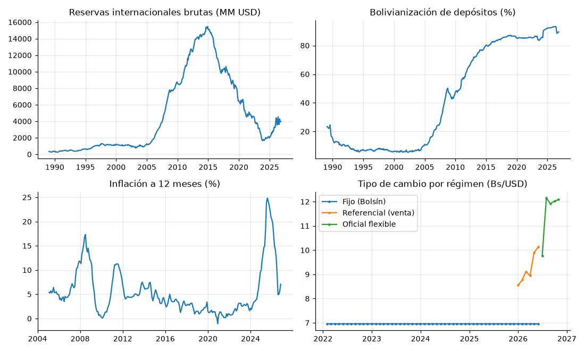

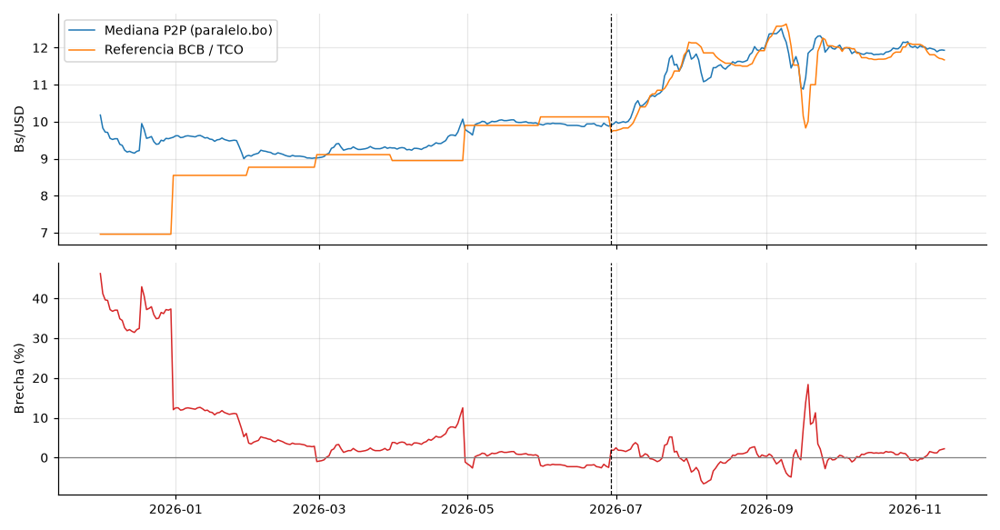

### Hallazgo: el efecto de valoración en la bolivianización

Los cuadros del BCB expresan los saldos en millones de **USD**: los depósitos en moneda extranjera están en dólares reales, pero los depósitos en bolivianos se convierten al tipo de cambio vigente. Al pasar el tipo de cambio de 6,96 a ~12, el saldo en bolivianos medido en USD cae mecánicamente. Con las mismas filas (moneda nacional y extranjera de los cuadros), entre 2025-09-30 y 2026-10-31 la bolivianización calculada **al tipo de cambio vigente** pasó de 92.1% a 88.5%, pero **a tipo de cambio constante (6,96)** pasó de 92.1% a 93.0%; los depósitos en dólares casi no cambiaron (2,654 → 2,578 MM USD). La caída es contable, no una fuga hacia el dólar. Por eso el índice de estrés usa la versión sin efecto de valoración. La cifra oficial del BCB (fila «Bolivianización», 92.7% → 89.5%) usa otra definición que difiere de la calculada hasta ~4 pp en 2023-24, probablemente por el tratamiento de depósitos con mantenimiento de valor (no verificado), por lo que **no se mezclan ambas**. Se verificó además que el BCB convirtió a 6,96 hasta may-2026, no al valor referencial.

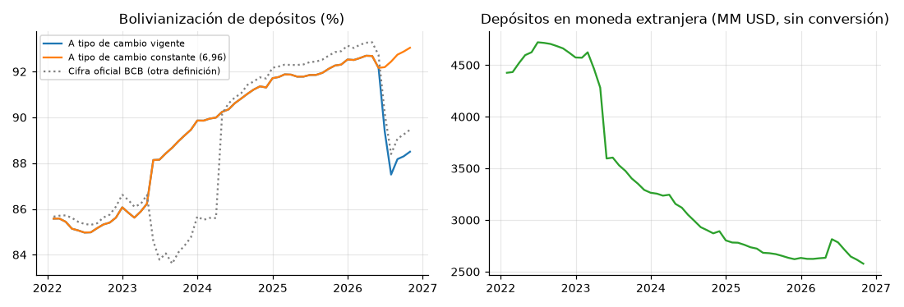

## 3. Métodos y resultados por capítulo del libro

### Cap. 1-2: procesos estocásticos y estacionariedad

Cada variable se trata como un proceso estocástico en tiempo discreto {X_t}. Un proceso es (débilmente) estacionario si su media y varianza son constantes y la autocovarianza depende solo del rezago. Se aplica la prueba de Dickey-Fuller aumentada (H0: raíz unitaria).

| variable | transformación | estadistico | p_valor | estacionaria_5% |
|---|---|---|---|---|
| rib | log | -1.551 | 0.508 | False |
| rib | Δlog ×100 | -2.892 | 0.046 | True |
| ipc | log | 0.896 | 0.993 | False |
| ipc | Δlog ×100 | -5.428 | 0.000 | True |
| depositos_me | log | -2.822 | 0.055 | False |
| depositos_me | Δlog ×100 | -10.368 | 0.000 | True |
| base_monetaria | log | -0.551 | 0.882 | False |
| base_monetaria | Δlog ×100 | -3.945 | 0.002 | True |

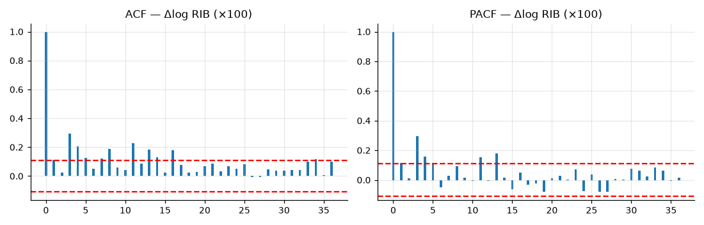

### Cap. 4: descomposición y suavizamiento exponencial

Descomposición clásica multiplicativa del IPC (periodo 12). Fuerza de la estacionalidad: 0.04 (el umbral habitual para diferenciar estacionalmente es 0,64), por lo que el IPC no requiere diferencia estacional. Holt-Winters (tendencia amortiguada + estacionalidad aditiva) se usa como modelo de referencia en la validación.

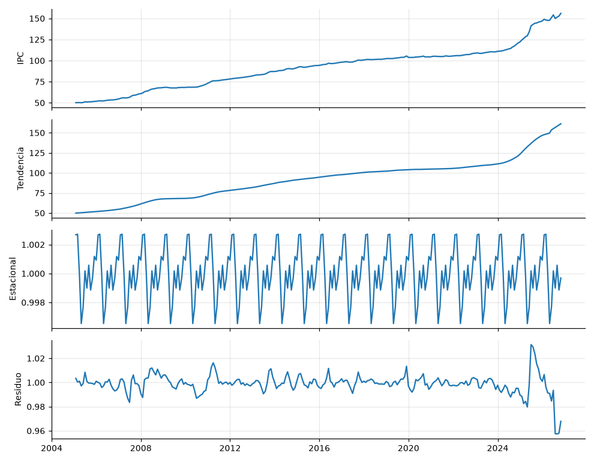

### Cap. 5: densidad espectral

El periodograma de Δlog RIB muestra sus mayores picos en periodos de: 2.8 meses, 11.9 meses, 2.8 meses. Solo se consideran periodos de hasta 60 meses: los más largos (del orden del tamaño de la muestra) no se distinguen de la tendencia. Un pico cercano a 12 meses indicaría estacionalidad anual.

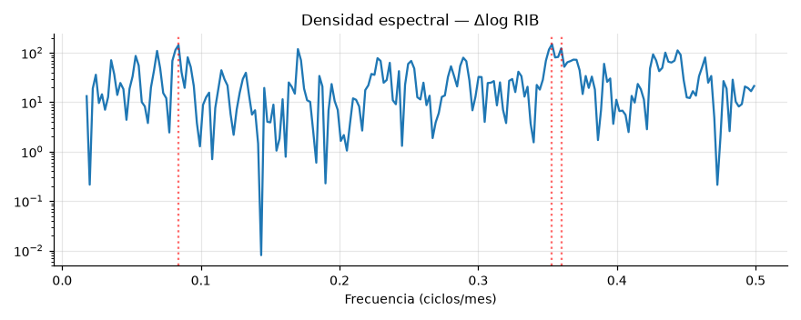

### Cap. 3: cadena de Markov

Índice de estrés = promedio de z-scores de: reservas, bolivianizacion (menos Δ12 log RIB, menos Δ6 de la bolivianización de depósitos a tipo de cambio constante). Estados por cuantiles del índice: Tensión desde 0.32 (percentil 60) y Crisis desde 0.72 (percentil 85). **Estos cortes son una decisión del autor**; la sección de robustez muestra su efecto.

| desde \ hacia | Estable | Tensión | Crisis |
|---|---|---|---|
| Estable | 0.932 | 0.064 | 0.004 |
| Tensión | 0.173 | 0.709 | 0.118 |
| Crisis | 0.000 | 0.224 | 0.776 |

Permanencia media (1/(1−p_ii)): Estable 14.7, Tensión 3.4, Crisis 4.5 meses.

Probabilidades desde el estado actual: a 1 mes(es): Estable 93.2%, Tensión 6.4%, Crisis 0.4%; a 3 mes(es): Estable 83.8%, Tensión 13.5%, Crisis 2.7%; a 6 mes(es): Estable 75.3%, Tensión 18.3%, Crisis 6.4%.

**Propiedad de Markov.** Independencia (χ², 4 g.l.): p = 2e-99, hay fuerte dependencia entre estados consecutivos. Orden 1 vs orden 2 (razón de verosimilitud, 8 g.l.): p = 0.00034. Se rechaza orden 1 al 5%: la cadena de primer orden es una aproximación; parte de la persistencia proviene de que el índice usa variaciones sobre ventanas móviles (12 y 6 meses) que se solapan. Con 441 transiciones el contraste es potente, pero las observaciones no son independientes.

**Validación con episodios conocidos** (fracción de meses en cada estado):

| episodio | meses | Estable | Tensión | Crisis |
|---|---|---|---|---|
| Bonanza 2006-2013 | 96 | 0.930 | 0.010 | 0.060 |
| Caída de reservas 2014-2019 | 72 | 0.460 | 0.460 | 0.080 |
| Pandemia 2020 | 12 | 0.000 | 0.330 | 0.670 |
| Escasez de dólares 2023-2025 | 35 | 0.460 | 0.090 | 0.460 |
| Transición cambiaria dic-2025→may-2026 | 6 | 1.000 | 0.000 | 0.000 |
| Régimen flexible jun-2026→ | 5 | 1.000 | 0.000 | 0.000 |

Lectura honesta: el índice de reservas y bolivianización **no refleja la tensión cambiaria de dic-2025→may-2026** (aparece como Estable). La brecha observada se analiza por separado: incorporarla solo desde 2024 cambiaría el número de componentes del índice a mitad de la muestra e invalidaría la comparación histórica de estados.

**Robustez a los umbrales:**

| q_tensión | q_crisis | π Estable | π Tensión | π Crisis | permanencia Estable | permanencia Tensión | permanencia Crisis | P(Estable→Estable) | P(Crisis→Crisis) |
|---|---|---|---|---|---|---|---|---|---|
| 0.500 | 0.800 | 0.520 | 0.290 | 0.190 | 13.750 | 4.120 | 5.560 | 0.930 | 0.820 |
| 0.600 | 0.850 | 0.620 | 0.240 | 0.140 | 14.670 | 3.440 | 4.470 | 0.930 | 0.780 |
| 0.670 | 0.900 | 0.680 | 0.220 | 0.090 | 16.330 | 3.400 | 3.750 | 0.940 | 0.730 |
| 0.700 | 0.950 | 0.720 | 0.240 | 0.040 | 18.120 | 4.780 | 3.830 | 0.940 | 0.740 |

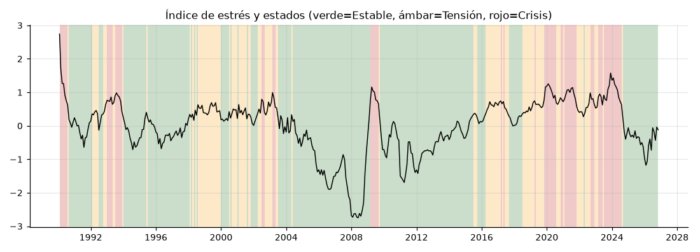
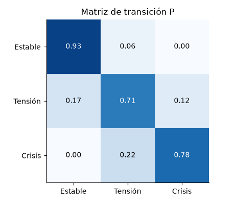

### Cap. 6: ARIMA/SARIMA (Box-Jenkins)

Ciclo: identificación (ADF para d, fuerza estacional para D, AIC para p,q,P,Q), estimación por máxima verosimilitud, diagnóstico (Ljung-Box y Jarque-Bera) y pronóstico con IC 95%. Se limita d ≤ 1 y se trabaja en logaritmos desde 2005.

| variable | orden | estacional | LB p(12) | LB p(24) | JB p | residuos blancos |
|---|---|---|---|---|---|---|
| rib | (2, 1, 2) | (0, 0, 0, 12) | 0.000 | 0.001 | 0.000 | no |
| ipc | (2, 1, 1) | (0, 0, 0, 12) | 0.040 | 0.001 | 0.000 | no |
| depositos_me | (1, 1, 1) | (0, 0, 0, 12) | 0.989 | 0.993 | 0.000 | sí |
| base_monetaria | (1, 0, 0) | (1, 0, 1, 12) | 0.099 | 0.008 | 0.001 | no |

Los residuos no son normales (colas pesadas por los quiebres de 2015, 2020 y 2023-2026); los intervalos del modelo gaussiano deben leerse con cautela.

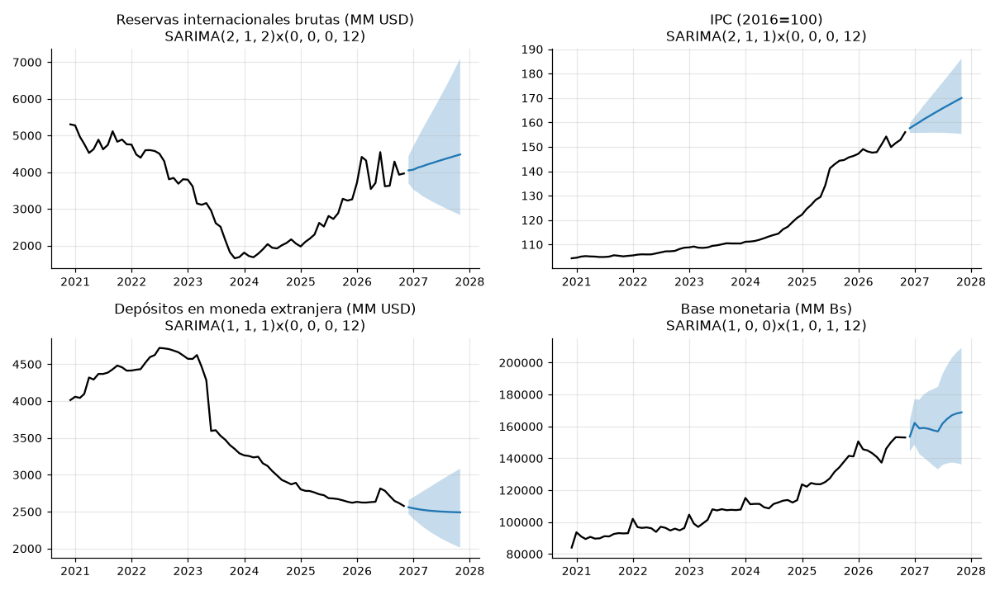

**Validación con ventana móvil** (24 orígenes, últimos 2 años; MAPE %):

| variable | horizonte (meses) | holt_winters | ingenuo | sarima | cobertura IC95 SARIMA |
|---|---|---|---|---|---|
| base_monetaria | 1 | 1.82 | 2.00 | 1.45 | 1.00 |
| base_monetaria | 3 | 3.79 | 4.35 | 3.19 | 1.00 |
| base_monetaria | 6 | 5.63 | 7.28 | 4.89 | 1.00 |
| depositos_me | 1 | 0.95 | 1.11 | 0.86 | 0.96 |
| depositos_me | 3 | 1.85 | 2.58 | 1.77 | 1.00 |
| depositos_me | 6 | 2.46 | 4.00 | 2.62 | 1.00 |
| ipc | 1 | 0.86 | 1.26 | 0.92 | 0.62 |
| ipc | 3 | 2.50 | 3.56 | 2.92 | 0.38 |
| ipc | 6 | 5.13 | 6.61 | 5.78 | 0.25 |
| rib | 1 | 7.70 | 6.94 | 7.67 | 0.54 |
| rib | 3 | 11.34 | 10.61 | 11.54 | 0.67 |
| rib | 6 | 17.41 | 16.62 | 20.03 | 0.62 |

Mejor modelo por MAPE: rib h=1: ingenuo; rib h=3: ingenuo; rib h=6: ingenuo; ipc h=1: holt_winters; ipc h=3: holt_winters; ipc h=6: holt_winters; depositos_me h=1: sarima; depositos_me h=3: sarima; depositos_me h=6: holt_winters; base_monetaria h=1: sarima; base_monetaria h=3: sarima; base_monetaria h=6: sarima.

**H4 (SARIMA supera al ingenuo):** rib: 0/3 horizontes; ipc: 3/3 horizontes; depositos_me: 3/3 horizontes; base_monetaria: 3/3 horizontes. Resultado mixto: la hipótesis se sostiene para algunas series y no para otras (en reservas el modelo ingenuo es difícil de superar en este período turbulento). Las coberturas del IC 95% por debajo de 95% indican intervalos demasiado estrechos frente a los quiebres.

### Cap. 7: Monte Carlo (GBM) y anomalías

Reservas simuladas con movimiento browniano geométrico: μ = 2.43% y σ = 9.08% mensuales (últimos 36 meses), 10.000 trayectorias a 6 meses desde 3,965 MM USD. Con umbral de 3,500: P(terminar por debajo) = 13.7%; P(cruzarlo en algún mes) = 26.8%. Supone retornos log-normales independientes y volatilidad constante, supuestos que los datos incumplen; es un escenario, no una predicción.

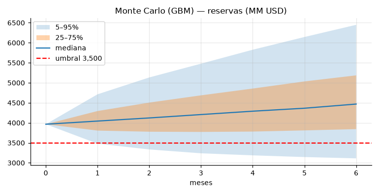

**Ejemplo del simulador cambiario:** USD 10,000 a 90 días. Hoy: Bs 116,700. Rango 5-50-95%: Bs 87,784 / 114,972 / 150,921. Parámetros: σ diaria 1.73% estimada con 104 variaciones del TCO desde ago-2026 y deriva 0. **Rango indicativo, sensible al régimen y a las colas pesadas.**

Detección de anomalías: residuos estandarizados de SARIMA con |z| > 2,5 (se descartan los primeros 24 meses por el arranque del filtro).

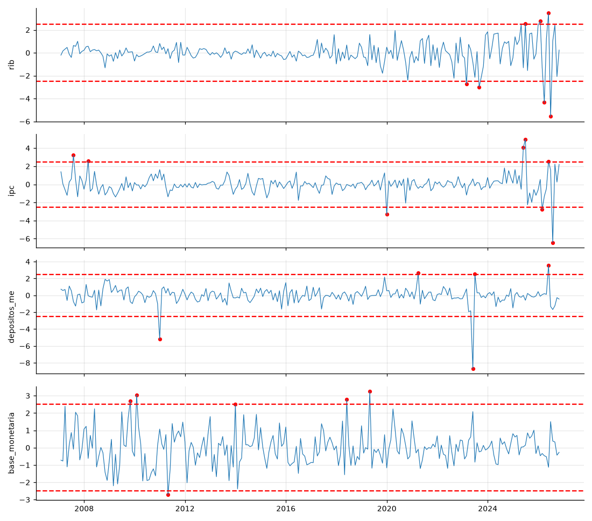

## 4. Régimen cambiario: evidencia descriptiva (H3)

| régimen | meses | var. mensual media % | desv. est. % |
|---|---|---|---|
| Fijo (nov-2011→nov-2025) | 168 | 0.000 | 0.000 |
| Referencial (dic-2025→may-2026) | 6 | 6.255 | 7.996 |
| Flexible (jun-2026→) | 5 | 3.538 | 10.437 |

La variación mensual del tipo de cambio de referencia es nula bajo el régimen fijo (2011-2025) y pasa a ser grande bajo el referencial y el flexible; esta descripción incluye el salto de transición jun→jul-2026. Para H3 formal se comparan retornos diarios de la misma mediana P2P entre 4-may y 3-sep-2026, antes del cambio de metodología del proveedor del 4-sep. Se reporta una sensibilidad que excluye la primera semana flexible.

## 5. Estado de las hipótesis

| # | Hipótesis | Resultado |
|---|---|---|
| H1 | Brecha estacionaria con vida media <30 días | n=138; φ=0.842; vida media=4.0 días; ADF p=8.86e-05. Compatible con estacionariedad y vida media <30 días. |
| H2 | Estados persistentes (Markov) | p_Estable→Estable=0.93; independencia rechazada; orden 1 rechazado (p=0.000) |
| H3 | Volatilidad cambia con el régimen | n=56/67; σ=0.47%/1.12%; razón=2.39; Levene p=3.82e-05. Cambio de volatilidad compatible con los datos. |
| H4 | SARIMA supera al ingenuo | Mixto (ver validación) |
| H5 | El paralelo se adelanta al oficial | n=97 días hábiles; correlación máxima en k=1: 0.658; Granger lag 1 paralelo→oficial p=9.21e-10, oficial→paralelo p=0.293. Compatible con adelanto del paralelo; no prueba causalidad. |

**Sensibilidad H3:** al excluir los primeros siete días del régimen flexible, razón de desviaciones=2.52, Levene p=1.71e-05 (n=56/60).

**Cautela H5:** el TCO se publica con rezago respecto a las transacciones bancarias y el paralelo se actualiza continuamente. Una correlación con k=1 puede reflejar el calendario de publicación. Granger mide capacidad predictiva condicional, no causalidad; los rezagos 2–5 son exploratorios.

## 6. Limitaciones

- El régimen flexible tiene pocas observaciones (desde jun-2026): todo lo post-cambio es exploratorio.
- El índice de estrés usa estandarización con toda la muestra y umbrales por cuantiles (decisión del autor); describe, no predice.
- Datos recientes del BCB son preliminares y se revisan.
- Los modelos gaussianos subestiman colas pesadas y quiebres.
- GARCH no se implementó (queda como extensión).

## 7. Referencias
- Material del curso DAT 262 (Procesos Estocásticos y Series de Tiempo).
- BCB, Estadísticas Semanales y Tabla de precios de activos virtuales.
- Seabold & Perktold (2010), statsmodels.